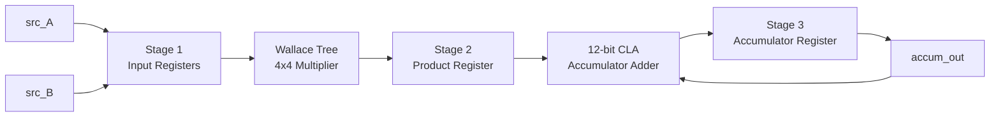

# 4-bit Pipelined MAC Unit — RTL to GDSII

[]()
[]()
[]()
[]()

A custom, structurally hand-built 4-bit **Multiply-Accumulate (MAC)** unit — the datapath building block behind DSPs, CNN accelerators, and FIR filters — taken from RTL through synthesis, place-and-route, and STA sign-off on the open-source SkyWater SKY130 PDK.

This is **Phase 2** of a larger custom-ASIC project. Phase 1 was a transistor-level 4-bit Wallace Tree Multiplier hand-drawn in Cadence Virtuoso; this project reuses that same multiplier architecture at the RTL level and extends it into a fully pipelined, accumulate-capable datapath carried all the way to layout.

---

## Table of Contents

- [Overview](#overview)
- [Architecture](#architecture)
- [Repository Structure](#repository-structure)
- [Module Reference](#module-reference)
- [Simulation](#simulation)
- [Verification](#verification)
- [Physical Design Results](#physical-design-results)
- [Toolchain](#toolchain)
- [Roadmap](#roadmap)

---

## Overview

At its core, this design computes `accum_out += A × B` on every enabled clock edge — the fundamental operation behind convolution, dot products, and digital filtering. Rather than relying on inferred `*` and `+` operators, every arithmetic block here is **built structurally from the gate level up**:

- A **4×4 Wallace tree multiplier**, reduced by hand using half adders, full adders, and a 6-bit carry-lookahead stage
- A **12-bit structural carry-lookahead adder (CLA)**, built by cascading three 4-bit CLA blocks with block-level generate/propagate signals for fast carry resolution
- A **3-stage pipeline** wrapping both, so the design can be clocked aggressively without the multiply-then-add critical path limiting frequency

## Architecture



| Stage | Function | Registers |
|-------|----------|-----------|
| 1 | Latch `src_A`, `src_B` on `en` | `reg_A`, `reg_B` |
| 2 | Wallace-tree multiply, register the 8-bit product | `piped_product` |
| 3 | 12-bit CLA adds the product into the running total | `accum_out` |

`clr_accum` synchronously zeroes the accumulator; `en` gates every stage so the pipeline holds state cleanly when disabled.

## Repository Structure

```
MAC_unit_4bit/
├── rtl/
│   ├── half_adder.v        # 1-bit half adder (base cell)
│   ├── full_adder.v        # 1-bit full adder (base cell)
│   ├── wallace_tree_4.v    # 4x4 Wallace-tree multiplier core
│   ├── CLA_4bit.v          # 4-bit carry-lookahead adder block
│   ├── CLA_12bit.v         # 12-bit structural CLA (3x CLA_4bit cascade)
│   └── mac_unit_4.v        # Top-level pipelined MAC unit
├── tb/
│   └── mac_4bit_tb.v       # Self-checking testbench + golden model
└── README.md
```

## Module Reference

| Module | Description | Depends on |
|---|---|---|
| `half_adder` | 1-bit XOR/AND sum-carry cell | — |
| `full_adder` | 1-bit adder built from two half adders | `half_adder` |
| `wallace_tree_4` | 4×4 partial-product Wallace-tree reduction with lookahead resolution | `half_adder`, `full_adder` |
| `CLA_4bit` | 4-bit carry-lookahead adder with block Pg/Gg outputs | — |
| `CLA_12bit` | 12-bit adder, 3× `CLA_4bit` cascaded with inter-block lookahead | `CLA_4bit` |
| `mac_unit_4` | Top-level 3-stage pipelined MAC | `wallace_tree_4`, `CLA_12bit` |

## Simulation

Simulated in **Xilinx Vivado**.

### Option A — Vivado GUI

1. Create a new RTL project (**File → Project → New**, "Do not specify sources at this time").
2. Add `rtl/*.v` as **Design Sources**.
3. Add `tb/mac_4bit_tb.v` as a **Simulation Source**, and set it as the simulation top (right-click → **Set as Top**).
4. In the Flow Navigator, go to **SIMULATION → Run Simulation → Run Behavioral Simulation**.
5. Inspect signals in the waveform viewer.

### Option B — Vivado batch mode (`xsim`)

```bash
xvlog rtl/half_adder.v rtl/full_adder.v rtl/wallace_tree_4.v \
  rtl/CLA_4bit.v rtl/CLA_12bit.v rtl/mac_unit_4.v tb/mac_4bit_tb.v
xelab mac_4bit_tb -s mac_4bit_tb_sim
xsim mac_4bit_tb_sim -runall
```

## Verification

`mac_4bit_tb.v` runs a self-checking golden reference model alongside the DUT, with 2-cycle input-history tracking for debug visibility on any mismatch. Coverage includes:

- Zero and maximum-value multiplication
- Walking-ones and alternating-bit input patterns
- An exhaustive 16×16 (256-combination) input sweep
- Accumulator clear (`clr_accum`) behavior
- Clock gating via `en`
- 500-vector randomized stress testing
- Accumulator overflow / wrap-around at the 12-bit boundary

The `wallace_tree_4` multiplier and `CLA_12bit` adder have each been independently verified exhaustively/randomly in isolation and are functionally correct. **Integration-level pipeline timing between the RTL and the testbench's golden model is currently being reconciled** — `mac_unit_4` has a 3-cycle input-to-output latency, and the testbench golden model is being updated to match. This section will be updated once full end-to-end verification passes cleanly.

## Physical Design Results

The Phase 1 predecessor of this multiplier (transistor-level, Cadence Virtuoso, 90nm CMOS) achieved a 2.02 GHz maximum operating frequency across 828 transistors. This RTL-level pipelined MAC has been carried through a full open-source RTL-to-GDSII flow on SKY130:

| Metric | Result |
|---|---|
| PDK | SkyWater SKY130 |
| Frequency range | 227.55 – 735.11 MHz |
| Corners evaluated | 9 (PVT × RC) |
| Timing violations | Zero, across all corners |
| Sign-off documentation | 25-page STA report with cross-corner comparison tables |

## Toolchain

| Purpose | Tool |
|---|---|
| RTL Design & Simulation | Xilinx Vivado |
| Synthesis | Yosys |
| Place & Route | OpenLane2 / OpenROAD |
| Static Timing Analysis | OpenSTA |
| Layout / DRC-LVS | Magic, KLayout |

## Roadmap

- [ ] Reconcile testbench golden-model latency with the RTL's 3-stage pipeline
- [ ] Add a `docs/` folder with the RTL-to-GDSII and STA sign-off reports
- [ ] Add waveform captures / GTKWave screenshots
- [ ] Add a Makefile for one-command simulation

---

*Part of a larger custom-ASIC portfolio project — Phase 1: [4-bit Wallace Tree Multiplier](https://github.com/GithubJayanta) (transistor-level, Cadence Virtuoso).*
