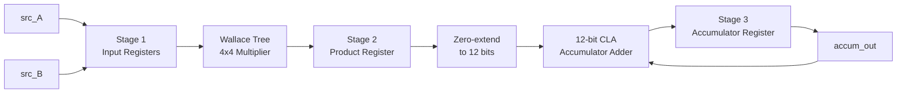

# 4-bit Pipelined MAC Unit — RTL to GDSII

[]()
[]()
[]()
[]()
[]()

A custom, structurally hand-built 4-bit **Multiply-Accumulate (MAC)** unit — the datapath building block behind DSPs, CNN accelerators, and FIR filters — taken from RTL through logic synthesis, place-and-route, and nine-corner STA sign-off on the open-source SkyWater Sky130A PDK, with the final layout streamed out to GDSII.

This is **Phase 2** of a larger custom-ASIC project. Phase 1 was a transistor-level 4-bit Wallace Tree Multiplier hand-drawn in Cadence Virtuoso (2.02 GHz max frequency, 828 transistors, 90nm CMOS); this project reuses that same multiplier architecture at the RTL level and extends it into a fully pipelined, accumulate-capable datapath carried all the way to layout.

---

## Table of Contents

- [Overview](#overview)
- [Architecture](#architecture)
- [Port List](#port-list)
- [Repository Structure](#repository-structure)
- [Module Reference](#module-reference)
- [Simulation](#simulation)
- [Verification](#verification)
- [Logic Synthesis](#logic-synthesis)
- [Physical Design Flow](#physical-design-flow)
- [Static Timing Analysis (STA) Signoff](#static-timing-analysis-sta-signoff)
- [Final GDSII Layout](#final-gdsii-layout)
- [Toolchain](#toolchain)
- [Roadmap](#roadmap)

---

## Overview

At its core, this design computes `accum_out += A × B` on every enabled clock edge — the fundamental operation behind convolution, dot products, and digital filtering. Rather than relying on inferred `*` and `+` operators, every arithmetic block here is **built structurally from the gate level up**:

- A **4×4 Wallace tree multiplier**, reduced by hand using half adders, full adders, and a 6-bit carry-lookahead stage
- A **12-bit structural carry-lookahead adder (CLA)**, built by cascading three 4-bit CLA blocks with block-level generate/propagate signals for fast carry resolution
- A **3-stage pipeline** wrapping both, so the multiply and accumulate paths don't sit in the same combinational path — the mechanism that lets this design close timing well above its 200 MHz target (see [STA Signoff](#static-timing-analysis-sta-signoff))

## Architecture



| Stage | Function | Registers |
|-------|----------|-----------|
| 1 — Input Reg. | Latch `src_A`, `src_B` on `en` | `reg_A[3:0]`, `reg_B[3:0]` |
| 2 — Multiply | Wallace-tree multiply, register the 8-bit product | `piped_product[7:0]` |
| 3 — Accumulate | Zero-extend to 12 bits, add into the running total via the 12-bit CLA, register back into `accum_out` | `accum_out[11:0]` |

`clr_accum` synchronously clears `accum_out` and takes priority over `en` on that register; `en` gates all three stages so the pipeline holds state cleanly when disabled. `accum_out` both feeds and is fed by the Stage-3 adder — the accumulate step is a synchronous feedback add rather than an unrolled sum-of-products chain.

## Port List

| Port | Dir | Width | Description |
|---|---|---|---|
| `clk` | in | 1 | System clock — signed off at 200 MHz (5 ns period) |
| `rst_n` | in | 1 | Active-low asynchronous reset; clears all pipeline registers and `accum_out` |
| `clr_accum` | in | 1 | Synchronous clear of `accum_out` only; priority over `en` |
| `en` | in | 1 | Global pipeline enable; gates all three stages |
| `src_A` | in | 4 | Multiplicand operand A (unsigned) |
| `src_B` | in | 4 | Multiplicand operand B (unsigned) |
| `accum_out` | out | 12 | Registered running sum of A×B products |

7 ports, 24 total signal bits.

## Repository Structure

```
MAC_unit_4bit/
├── rtl/
│   ├── half_adder.v        # 1-bit half adder (base cell)
│   ├── full_adder.v        # 1-bit full adder (base cell)
│   ├── wallace_tree_4.v    # 4x4 Wallace-tree multiplier core
│   ├── CLA_4bit.v          # 4-bit carry-lookahead adder block
│   ├── CLA_12bit.v         # 12-bit structural CLA (3x CLA_4bit cascade)
│   └── mac_unit_4.v        # Top-level pipelined MAC unit
├── tb/
│   └── mac_4bit_tb.v       # Self-checking testbench + golden model
└── README.md
```

## Module Reference

Everything below the top level is structural — every arithmetic block is built from hand-instantiated half- and full-adders rather than Verilog's `*` / `+` operators.

| Module | Description | Depends on |
|---|---|---|
| `half_adder` | 1-bit XOR/AND sum-carry cell | — |
| `full_adder` | 1-bit adder built from two half adders + OR gate for cout | `half_adder` |
| `wallace_tree_4` | 4×4 partial-product AND array, reduced by a Wallace tree of half/full adders, final row resolved by a custom 6-bit carry-lookahead stage | `half_adder`, `full_adder` |
| `CLA_4bit` | 4-bit carry-lookahead adder with block-level Pg/Gg outputs for cascading | — |
| `CLA_12bit` | 12-bit adder, 3× `CLA_4bit` cascaded with inter-block lookahead (bits [3:0], [7:4], [11:8]) | `CLA_4bit` |
| `mac_unit_4` | Top-level 3-stage pipelined MAC | `wallace_tree_4`, `CLA_12bit` |

## Simulation

Simulated in **Xilinx Vivado**.

### Option A — Vivado GUI

1. Create a new RTL project (**File → Project → New**, "Do not specify sources at this time").
2. Add `rtl/*.v` as **Design Sources**.
3. Add `tb/mac_4bit_tb.v` as a **Simulation Source**, and set it as the simulation top (right-click → **Set as Top**).
4. In the Flow Navigator, go to **SIMULATION → Run Simulation → Run Behavioral Simulation**.
5. Inspect signals in the waveform viewer.

### Option B — Vivado batch mode (`xsim`)

```bash
xvlog rtl/half_adder.v rtl/full_adder.v rtl/wallace_tree_4.v \
  rtl/CLA_4bit.v rtl/CLA_12bit.v rtl/mac_unit_4.v tb/mac_4bit_tb.v
xelab mac_4bit_tb -s mac_4bit_tb_sim
xsim mac_4bit_tb_sim -runall
```

## Verification

`mac_4bit_tb.v` runs a self-checking golden reference model alongside the DUT, with a 2-stage input-history chain (`hist_A_p1/p2`, `hist_B_p1/p2`, `hist_en_p1/p2`, `hist_clr_p1/p2`) for tracing any mismatch back to the exact input sample that caused it, plus an `error_count` register as a single pass/fail signal. Stimulus coverage includes:

- Zero and maximum-value multiplication
- Walking-ones and alternating-bit input patterns
- An exhaustive 16×16 (256-combination) input sweep
- Accumulator clear (`clr_accum`) behavior
- Clock gating via `en`
- 500-vector randomized stress testing
- Accumulator overflow / wrap-around at the 12-bit boundary

The `wallace_tree_4` multiplier and `CLA_12bit` adder have each been independently verified exhaustively/randomly in isolation and are functionally correct. **Integration-level pipeline timing between the RTL and the testbench's golden model is currently being reconciled** — `mac_unit_4` has a 3-register input-to-output pipeline (`reg_A`/`reg_B` → `piped_product` → `accum_out`), while the testbench's golden model currently uses only 2 registers (`product_pipe1` → `expected`), which produces a one-cycle mismatch on the first non-trivial vector. This section will be updated once the golden model's pipeline depth is corrected and a clean end-to-end run is confirmed.

## Logic Synthesis

RTL was synthesized with **Yosys**, targeting the SkyWater Sky130A `sky130_fd_sc_hd` standard-cell library (the same mapping OpenLane2 drives internally).

| Metric | Result |
|---|---|
| Synthesized cell count | 223 standard cells |
| Sequential cells | 28× `sky130_fd_sc_hd__dfrtp_2` (reset D flip-flops) |
| Register cross-check | 28 DFFs = `reg_A`(4) + `reg_B`(4) + `piped_product`(8) + `accum_out`(12) — exact match to RTL state, confirming no registers were added/dropped/retimed |
| Dominant logic style | Wide AND-OR-INVERT / NAND-NOR compound gates (carry-lookahead sum-of-products), rather than XOR-heavy ripple structures — the expected signature of a CLA-based design |

## Physical Design Flow

Carried through the full **OpenLane2 / OpenROAD** flow and reviewed stage-by-stage in the OpenROAD GUI:

| # | Stage | Notes |
|---|---|---|
| 1 | Floorplanning | Single-row-height core, I/O pins placed for the 24 signal bits, PG straps stitched |
| 2 | Global Placement | 223 cells coarsely placed; hierarchy-driven clustering visible (Wallace-tree and CLA lookahead logic form distinct local clusters) |
| 3 | Detailed Placement | Cells legalized to rows/sites, no overlaps |
| 4 | Clock Tree Synthesis | Worst skew < 0.042 ns across all 9 signoff corners |
| 5 | Global Routing | Track-level route plan on met1/met2 + PG straps |
| 6 | Detailed Routing | Fully routed, DRC-clean geometry; source of SPEF parasitics for STA |

Estimated core area (read from the on-screen scale bar, not a signoff die-area report): **≈ 75–80 µm per side, ≈ 5,700–6,400 µm²**.

## Static Timing Analysis (STA) Signoff

Post-layout STA was run with **OpenSTA** using post-route SPEF parasitics and Sky130A signoff Liberty models, across the full mandated 3×3 matrix — three PVT corners (FF / TT / SS) × three RC extraction corners (min / nom / max) — for **9 total corners**, at a 200 MHz (5.000 ns) clock target.

| Corner | Setup WS (ns) | Hold WS (ns) | Fmax (MHz) | Margin vs 200 MHz | Power (mW) |
|---|---|---|---|---|---|
| min_ff_n40C_1v95 (best-case) | +3.6397 | +0.2861 | **735.11** | +268% | 1.0501 |
| nom_tt_25C_1v80 (nominal) | +2.8436 | +0.2933 | 463.73 | +132% | 0.9274 |
| max_ss_100C_1v60 (worst-case) | +0.6055 | +0.3494 | **227.55** | +14% | 0.7419 |

- **Setup / hold / DRC violations: 0 in every one of the 9 corners.**
- Worst-case Fmax (227.55 MHz, max_ss_100C_1v60) still clears the 200 MHz target with 13.8% margin.
- Power scales inversely with speed: fast FF corners at 1.95V draw the most (up to 1.0718 mW), slow SS corners at 1.60V draw the least (down to 0.7273 mW) — the expected voltage-dependent dynamic-power trend.
- Power breakdown is fairly balanced: clock network ≈ 27–28%, sequential logic ≈ 36–38%, combinational logic ≈ 34–36% of total, across all corners.

Full per-corner critical-path, skew, and power breakdowns are in the companion STA sign-off report.

## Final GDSII Layout

The signed-off design was streamed to GDSII and independently reviewed in **KLayout** (outside the OpenROAD/OpenLane2 environment) as a cross-tool sanity check — full Sky130A layer stack (nwell/pwell, diffusion, poly, tap, licon, local interconnect) confirmed consistent with the OpenROAD routed database.

## Toolchain

| Purpose | Tool |
|---|---|
| RTL Design & Simulation | Xilinx Vivado |
| Synthesis | Yosys |
| Place & Route | OpenLane2 / OpenROAD |
| Static Timing Analysis | OpenSTA |
| Layout / GDS Review | Magic, KLayout |

## Roadmap

- [ ] Reconcile testbench golden-model latency with the RTL's 3-stage pipeline, then re-confirm a clean (0-mismatch) end-to-end run
- [ ] DRC / LVS physical verification ahead of tapeout sign-off
- [ ] Add a `docs/` folder with the full RTL-to-GDSII and STA sign-off reports
- [ ] Add waveform captures / GTKWave screenshots
- [ ] Add a Makefile for one-command simulation

---

*Part of a larger custom-ASIC portfolio project — Phase 1: [4-bit Wallace Tree Multiplier](https://github.com/GithubJayanta) (transistor-level, Cadence Virtuoso, 2.02 GHz @ 90nm).*
